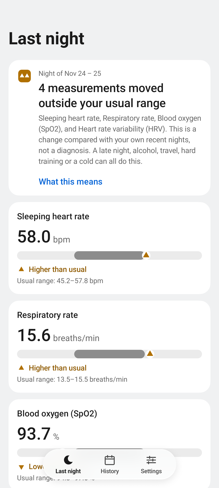
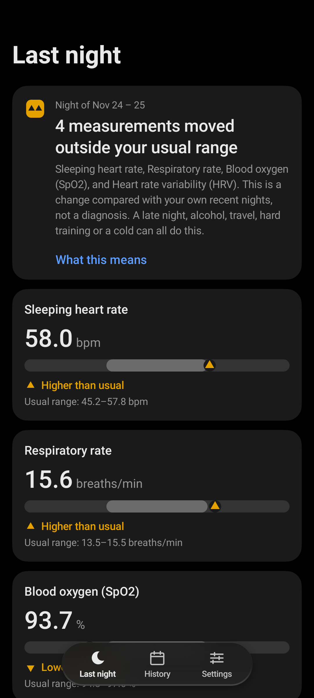
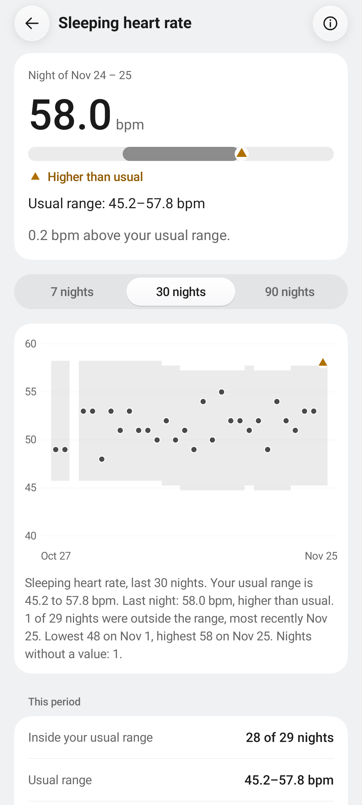
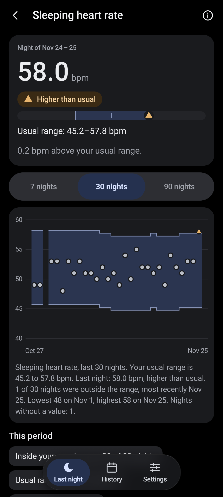
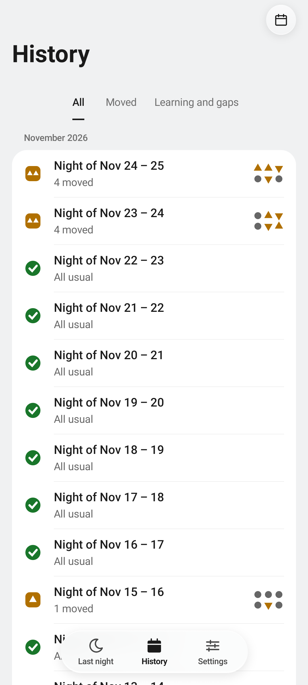
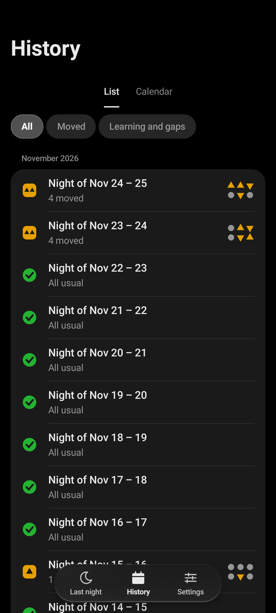
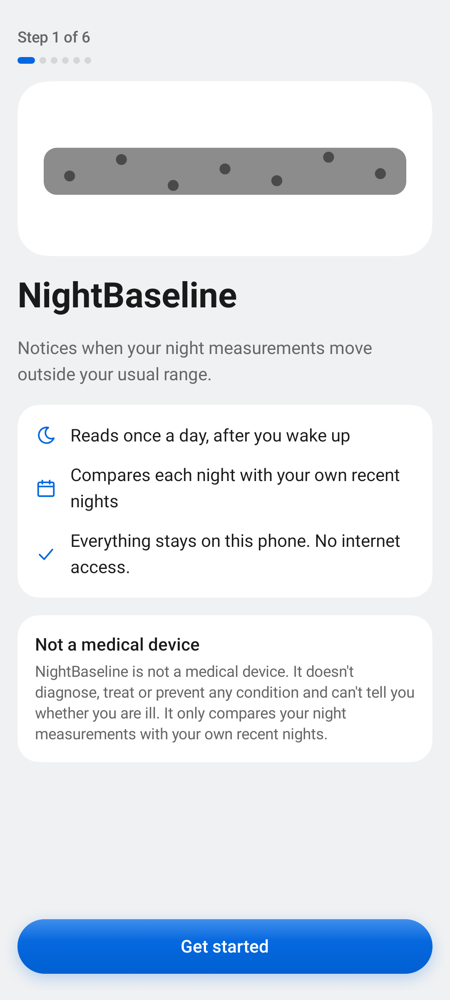
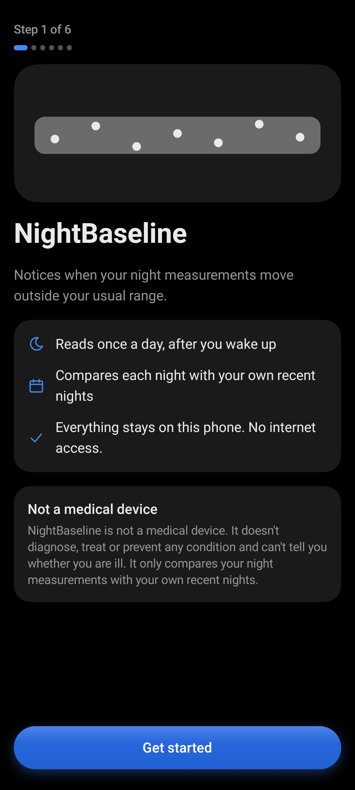
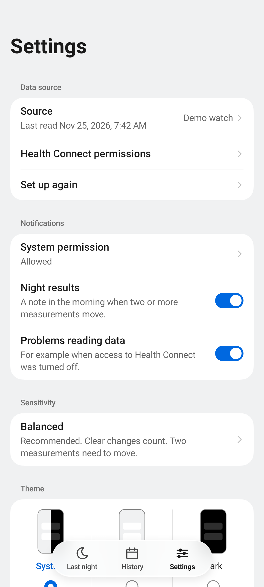
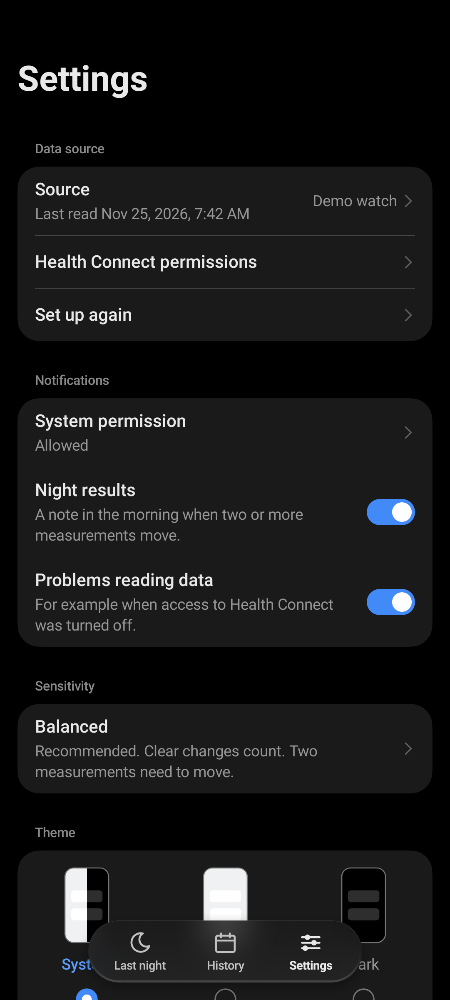

# NightBaseline

[](https://github.com/alien2003/NightBaseline/actions/workflows/ci.yml)

[Latest release](https://github.com/alien2003/NightBaseline/releases/latest) · [Licence: Apache-2.0](LICENSE) ·
[User guide](docs/user-guide.md) · [Privacy](docs/privacy.md) · [Documentation index](docs/README.md) ·
[README in Russian](README.ru.md)


## TL;DR

**What it does.** Once a day, after you wake up, NightBaseline reads last night's measurements from Health Connect
(sleeping heart rate, respiratory rate, blood oxygen, sleep duration, and HRV and skin temperature if your source
records them), compares each one with your own recent nights and shows whether they stayed within your usual range.
When two or more measurements moved outside your usual range on the same night, it sends one calm note in the
morning. Everything happens on the phone: the app has no internet permission and only reads from Health Connect. It
is not a medical device and makes no diagnosis.

You need Android 9 or later, Health Connect, and a watch or ring app that writes sleep sessions and heart rate to
Health Connect. The default and first tested source is OHealth (OPPO watches); any other source app should work.

1. **Install** with [Obtainium](https://github.com/ImranR98/Obtainium) (tap the button on the phone) or download
   `NightBaseline-<version>.apk` from the [latest release](https://github.com/alien2003/NightBaseline/releases/latest).

   [][obtainium-import] ·
   [Latest release](https://github.com/alien2003/NightBaseline/releases/latest)
2. **Set up.** Open NightBaseline and follow the six first-run steps: choose your source app, allow reading in Health
   Connect, allow notifications.
3. **Wait or use your history.** With access to past data, NightBaseline uses up to 60 earlier nights and starts
   comparing right away. Otherwise it learns your usual range over the first 7 nights with sleep data.
4. **Use it.** Open the app in the morning, or do nothing and wait for a note. Each measurement shows its value, your
   usual range and a plain label: "Usual", "Higher than usual" or "Lower than usual".

---

- [Screenshots](#screenshots)
- [How it works](#how-it-works)
- [Requirements](#requirements)
- [Install](#install)
- [Tested sources](#tested-sources)
- [Privacy](#privacy)
- [Not a medical device](#not-a-medical-device)
- [Documentation](#documentation)
- [Project status](#project-status)
- [Licence](#licence)

## Screenshots

The screenshots contain no real health data: they are rendered on the JVM by the app's screenshot tests from
synthetic nights ([docs/development.md](docs/development.md#screenshots)).

| Screen | Light | Dark |
|---|---|---|
| Home ("Last night") |  |  |
| Metric detail |  |  |
| History |  |  |
| First run |  |  |
| Settings |  |  |

## How it works

1. **The night.** NightBaseline reads the sleep sessions of the source app you chose and picks the main night of each
   date. Pieces of a night interrupted by a wake-up are joined; naps are ignored. Nights under 3 hours are shown but
   not compared.
2. **Waiting for the whole night.** Source apps often upload a night in several parts, and some measurements arrive
   up to an hour late. NightBaseline waits until you are up and the data has stopped changing (at most 12 hours after
   the end of the night), then evaluates the night once.
3. **One value per measurement.** For example, the sleeping heart rate is the settled low level of the night (the
   10th percentile of the samples after the first 30 minutes), computed by NightBaseline from the raw samples. A
   measurement with too few readings simply does not count that night.
4. **Your usual range.** For each measurement, the middle value of your last 28 valid nights (at most 60 days back),
   plus or minus how much your nights normally vary. It needs 7 nights to start.
5. **The result.** A measurement counts as outside when it is clearly away from your middle value, both statistically
   and by a minimum amount. Only the direction that matters counts: higher heart rate and respiratory rate, lower
   blood oxygen and HRV. One measurement moving on its own is common and is only shown in the app; a note is sent
   when two or more move on the same night. Sleep duration counts only together with another measurement.

Every rule and number is in [ALGORITHM.md](ALGORITHM.md), with the reasons and the validation: on synthetic people the
default settings sent a false note on 0.05 % of normal nights and found 196 of 200 simulated episodes.

## Requirements

- **Android 9 or later.**
- **Health Connect.** Part of the system on Android 14 and later; on Android 9–13 the Health Connect app from Google
  Play (the app offers to install or update it). The Android 9–13 path has not been tested on a device yet.
- **A source app** that writes **sleep sessions and heart rate** to Health Connect. Respiratory rate, blood oxygen,
  HRV and skin temperature are used when the source writes them; new types are picked up automatically.

## Install

**With Obtainium.** [Obtainium](https://github.com/ImranR98/Obtainium) is a free, open-source app that installs apps
from their release pages and keeps them up to date. Install Obtainium, open this page on the phone and tap the button;
Obtainium shows the import ("Import app"), then install NightBaseline from Obtainium. The button opens a redirect page
of Obtainium's app directory, which loads an ad and an analytics script; the
[user guide](docs/user-guide.md#install-and-update-with-obtainium) lists the settings it carries and how to add the
app by hand instead.

[][obtainium-import]

**From Releases.** Download `NightBaseline-<version>.apk` from the
[Releases page](https://github.com/alien2003/NightBaseline/releases) and open it on the phone. Android asks once to
allow the browser or file manager to install apps. A newer release installs over the old one as an update and keeps
your data and permissions. The app has no update check of its own.

**Verify the download.** Each release ships `SHA256SUMS.txt` (`sha256sum -c SHA256SUMS.txt` checks the file). The
stronger check is the signing certificate: `apksigner verify --print-certs NightBaseline-<version>.apk` (Android SDK
build-tools) must print this SHA-256 digest, the same for every release:

```
26:EC:1D:EC:35:93:AD:CE:D2:68:BB:64:1E:CB:74:7B:2E:8B:15:42:D5:66:24:78:20:2F:E0:C6:B1:F4:D3:77
```

`apksigner` prints it in lower case without colons
(`26ec1dec3593adced268bb641ecb747b2e8b1542d5662478202fe0c6b1f4d377`). The release notes print it too
([SECURITY.md](SECURITY.md#verifying-a-download)).

## Tested sources

| App | Metrics written to Health Connect | Frequency |
|---|---|---|
| OHealth (`com.heytap.health.international`) with an OPPO Watch X3 | Sleep sessions (without stages) | One night, often split into 2–4 sessions; rewritten the next morning |
| | Heart rate | Every 2 min |
| | Blood oxygen (SpO2) | About every 30 min at night |
| | Respiratory rate | Every 5–13 min, during sleep only |
| | HRV, skin temperature | Not written |

**Other sources:** untested. Any app should work if it writes sleep sessions and heart rate to Health Connect; reports
are welcome as [issues](https://github.com/alien2003/NightBaseline/issues). Sessions written by PulseStages are
always ignored, because they are derived from the same heart rate.

## Privacy

- **No internet permission.** The manifest removes `INTERNET` and `ACCESS_NETWORK_STATE`; a test of the merged
  manifests and the release build both fail if one comes back.
- **Read-only.** NightBaseline declares only Health Connect READ permissions. It never writes, changes or deletes
  health data.
- **On the phone only.** It stores one summary per night (the nightly values and their evaluation) in its private
  storage, excluded from Android backups. Uninstalling the app deletes it.
- **No analytics, no accounts, no ads.**

Details: [docs/privacy.md](docs/privacy.md).

## Not a medical device

NightBaseline is not a medical device. It doesn't diagnose, treat or prevent any condition and can't tell you whether
you are ill. It only compares your night measurements with your own recent nights. A measurement that moved outside
your usual range is a change compared with your own recent nights, not a diagnosis: late meals, alcohol, travel, hard
training, a cold, new medication or how the device sits on the wrist can all play a part. If you feel unwell or are
worried, talk to a health professional.

## Documentation

| Document | What it covers |
|---|---|
| [docs/user-guide.md](docs/user-guide.md) | First run, every screen and state, learning period, settings, notifications, FAQ, troubleshooting |
| [docs/privacy.md](docs/privacy.md) | Privacy policy: what is read, what is stored, deletion |
| [ALGORITHM.md](ALGORITHM.md) | The algorithm, every parameter and the validation |
| [docs/development.md](docs/development.md) | Setup, build, tests, tools, CI and releases |
| [CHANGELOG.md](CHANGELOG.md) | Changes per release |
| [CONTRIBUTING.md](CONTRIBUTING.md) | Bug reports, pull requests, commit style |
| [SECURITY.md](SECURITY.md) | Reporting a vulnerability, signing key policy |
| [docs/README.md](docs/README.md) | Index of all documents, including design, decisions and research |

## Project status

- **Current release: 0.1.0** (2026-11-26, [CHANGELOG.md](CHANGELOG.md)). First public version; feedback and source
  reports are welcome in GitHub issues.
- **Tested on a device:** the on-device suite ([tools/device-test](tools/device-test/README.md)) passes on the
  developer's phone, and real nights from OHealth are processed automatically.
- **Platform.** Android 9 and later (minSdk 28, targetSdk 36, compileSdk 37). Developed on an OPPO book foldable with
  Android 17 and ColorOS 17; the layouts adapt to phones, foldables (both screens, tabletop and book postures) and
  tablets.
- **Languages.** English and Russian; the app follows the phone's language.
- **Verified so far:** one source (OHealth). The defaults were checked against the developer's own history (aggregates
  only, [ALGORITHM.md §7](ALGORITHM.md#7-validation)); no labelled illness episodes exist in that history, so only
  the false-alarm side could be judged on real data.

## Licence

Apache License 2.0. See [LICENSE](LICENSE) and [NOTICE](NOTICE).

OHealth, OPPO, Health Connect, PulseStages and Obtainium are names of their respective owners. NightBaseline is an
independent open-source project and uses no vendor SDKs or resources.

<!-- The "Get it on Obtainium" buttons: Obtainium's web redirect to an obtainium://app/ import link (GitHub drops
     obtainium:// links). The settings it carries are listed in docs/user-guide.md, "Install and update with
     Obtainium"; README.ru.md and that section have the same link. docs/development.md, "Obtainium link", rebuilds it.
     The button image docs/get-it-on-obtainium.svg was drawn for PulseStages (not Obtainium's artwork) and copied. -->
[obtainium-import]: https://apps.obtainium.imranr.dev/redirect?r=obtainium://app/%7B%22id%22%3A%22io.github.alien2003.nightbaseline%22%2C%22url%22%3A%22https%3A%2F%2Fgithub.com%2Falien2003%2FNightBaseline%22%2C%22author%22%3A%22alien2003%22%2C%22name%22%3A%22NightBaseline%22%2C%22additionalSettings%22%3A%22%7B%5C%22includePrereleases%5C%22%3Afalse%2C%5C%22apkFilterRegEx%5C%22%3A%5C%22%5ENightBaseline-%5B0-9.%5D%2B%5C%5C%5C%5C.apk%24%5C%22%2C%5C%22allowedSigningCertHashes%5C%22%3A%5C%2226ec1dec3593adced268bb641ecb747b2e8b1542d5662478202fe0c6b1f4d377%5C%22%7D%22%7D
