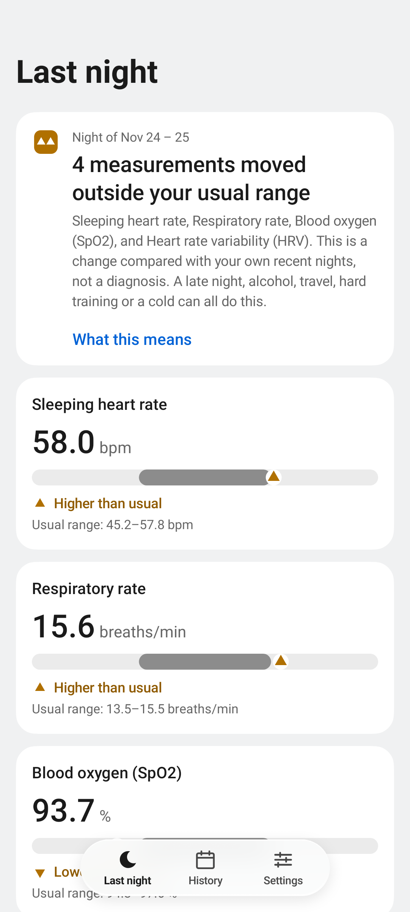
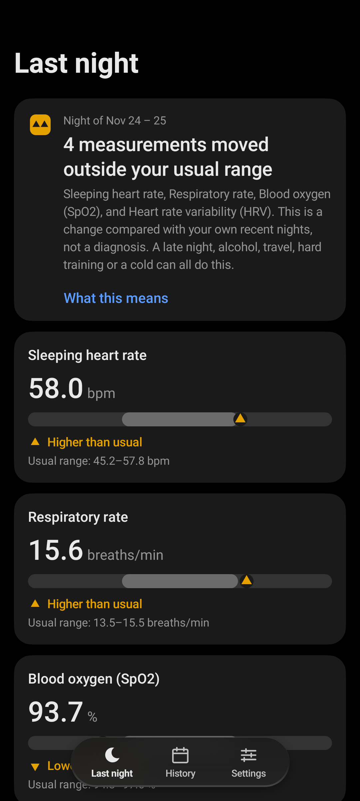
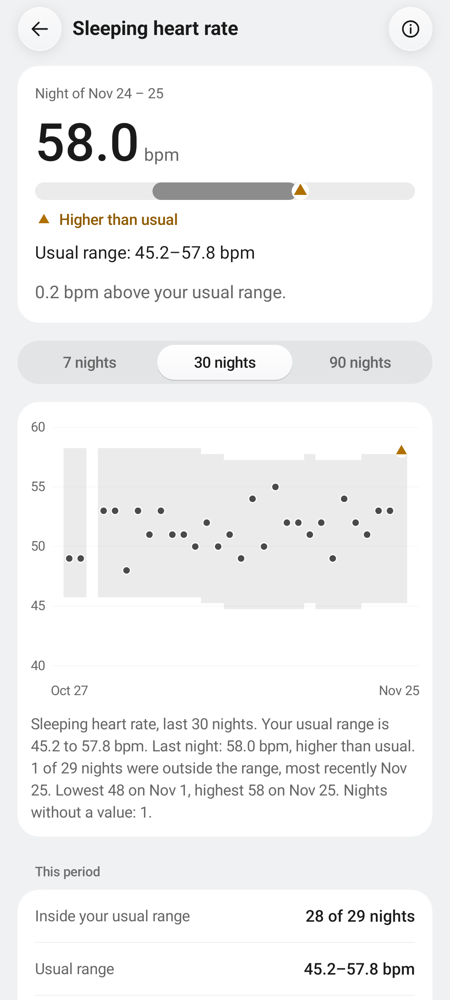
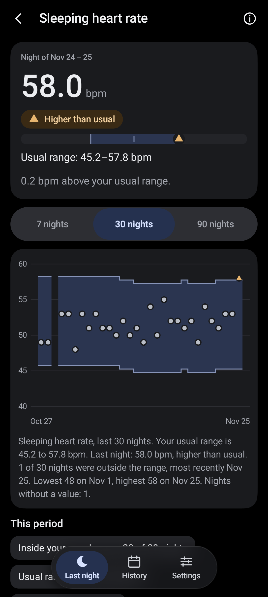
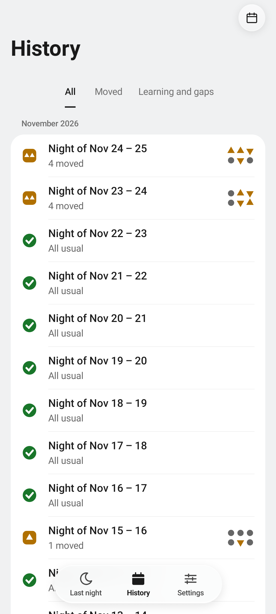
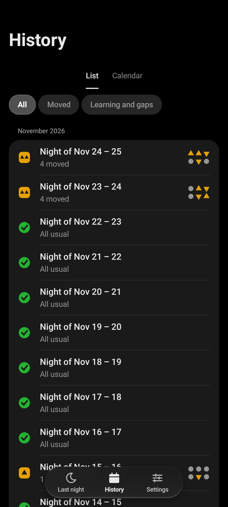
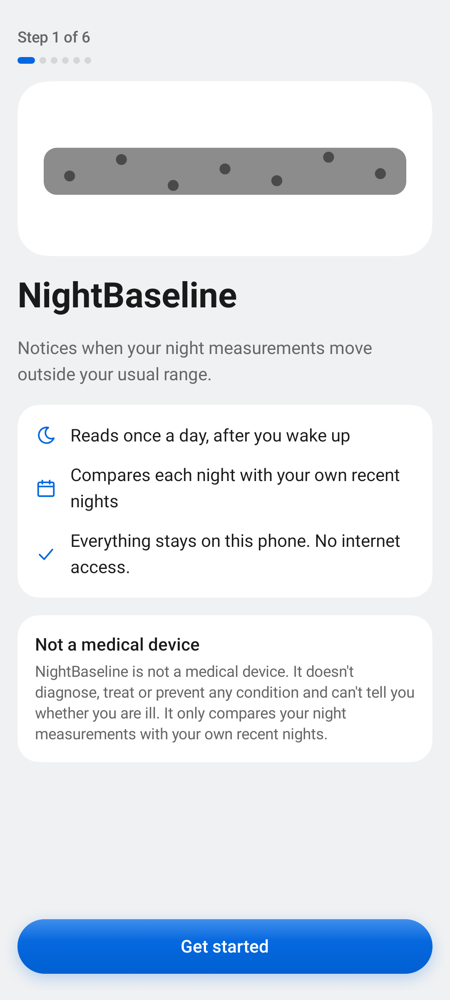
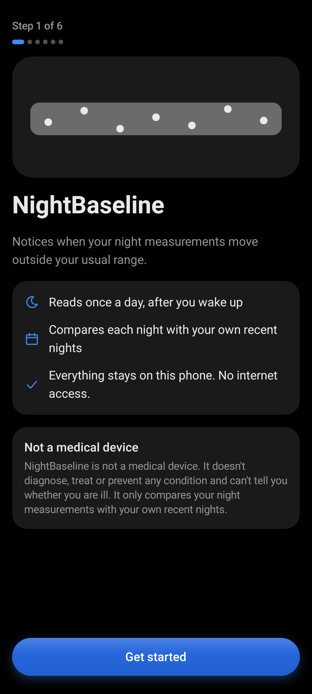
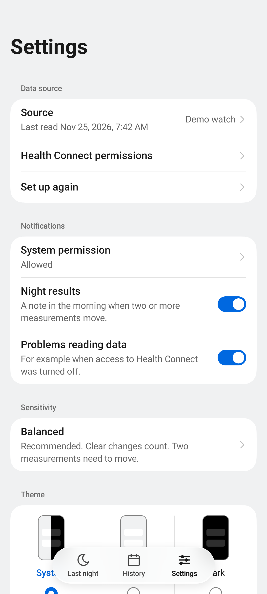
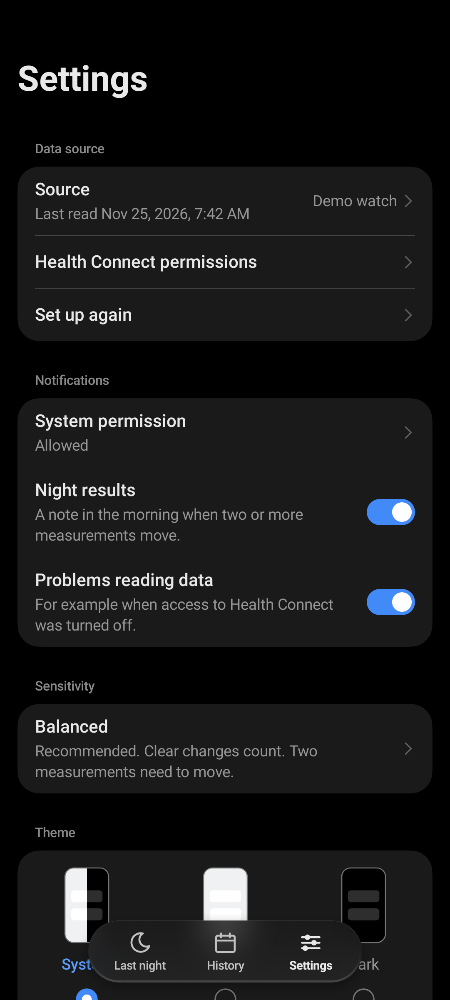

# NightBaseline

[](https://github.com/alien2003/NightBaseline/actions/workflows/ci.yml)

[Последний релиз](https://github.com/alien2003/NightBaseline/releases/latest) · [Лицензия: Apache-2.0](LICENSE) ·
[Руководство пользователя](docs/user-guide.md) (англ.) · [Конфиденциальность](docs/privacy.md) (англ.) ·
[Указатель документации](docs/README.md) (англ.) · [English](README.md)

## Коротко

**Что делает.** Раз в день, после того как вы проснулись, NightBaseline читает из Health Connect показатели прошедшей
ночи (пульс во сне, частоту дыхания, кислород в крови, длительность сна, а также ВСР и температуру кожи, если их
записывает ваш источник), сравнивает каждый с вашими собственными недавними ночами и показывает, остались ли они в
вашем обычном диапазоне. Если в одну ночь два показателя или больше вышли за пределы вашего обычного диапазона,
приложение утром присылает одно спокойное уведомление. Всё происходит на телефоне: у приложения нет доступа в интернет,
и оно только читает данные из Health Connect. Это не медицинское изделие, и оно не ставит диагнозов.

Нужны Android 9 или новее, Health Connect и приложение часов или кольца, которое записывает в Health Connect сессии
сна и пульс. Источник по умолчанию и первый проверенный — OHealth (часы OPPO); другие приложения-источники тоже должны
работать.

1. **Установите** через [Obtainium](https://github.com/ImranR98/Obtainium) (нажмите кнопку на телефоне) или скачайте
   `NightBaseline-<версия>.apk` из [последнего релиза](https://github.com/alien2003/NightBaseline/releases/latest).

   [][obtainium-import] ·
   [Последний релиз](https://github.com/alien2003/NightBaseline/releases/latest)
2. **Настройте.** Откройте NightBaseline и пройдите шесть шагов первого запуска: выберите приложение-источник,
   разрешите чтение в Health Connect, разрешите уведомления.
3. **Подождите или используйте историю.** С доступом к прошлым данным NightBaseline берёт до 60 предыдущих ночей и
   начинает сравнивать сразу. Иначе он изучает ваш обычный диапазон за первые 7 ночей с данными о сне.
4. **Пользуйтесь.** Откройте приложение утром или ничего не делайте и ждите уведомления. Для каждого показателя видны
   значение, ваш обычный диапазон и простая метка: «Как обычно», «Выше обычного» или «Ниже обычного».

---

- [Скриншоты](#скриншоты)
- [Как это работает](#как-это-работает)
- [Требования](#требования)
- [Установка](#установка)
- [Проверенные источники](#проверенные-источники)
- [Конфиденциальность](#конфиденциальность)
- [Не медицинское изделие](#не-медицинское-изделие)
- [Документация](#документация)
- [Состояние проекта](#состояние-проекта)
- [Лицензия](#лицензия)

## Скриншоты

На скриншотах нет реальных данных о здоровье: их отрисовывают на JVM скриншот-тесты приложения из синтетических ночей
([docs/development.md](docs/development.md#screenshots), англ.).

| Экран | Светлая тема | Тёмная тема |
|---|---|---|
| Главная («Прошлая ночь») |  |  |
| Показатель |  |  |
| История |  |  |
| Первый запуск |  |  |
| Настройки |  |  |

## Как это работает

1. **Ночь.** NightBaseline читает сессии сна выбранного приложения-источника и находит основную ночь каждой даты.
   Части ночи, прерванной пробуждением, объединяются; дневной сон не учитывается. Ночи короче 3 часов показываются,
   но не сравниваются.
2. **Ожидание всей ночи.** Источники часто выгружают ночь в несколько приёмов, а некоторые показатели приходят с
   опозданием до часа. NightBaseline ждёт, пока вы встанете и данные перестанут меняться (не дольше 12 часов после
   конца ночи), и затем один раз оценивает ночь.
3. **Одно значение на показатель.** Например, пульс во сне — это установившийся низкий уровень ночи (10-й процентиль
   замеров после первых 30 минут), который NightBaseline вычисляет сам из исходных замеров. Показатель, для которого
   замеров слишком мало, в эту ночь просто не учитывается.
4. **Ваш обычный диапазон.** Для каждого показателя — середина ваших последних 28 подходящих ночей (не дальше 60 дней
   назад) плюс-минус то, насколько ваши ночи обычно различаются. Для начала нужно 7 ночей.
5. **Результат.** Показатель считается вышедшим за диапазон, когда он явно далёк от вашей середины — и статистически,
   и на минимальную величину. Учитывается только важное направление: более высокие пульс и частота дыхания, более
   низкие кислород в крови и ВСР. Один сместившийся показатель — обычное дело, он только показывается в приложении;
   уведомление приходит, когда в одну ночь сместились два показателя или больше. Длительность сна учитывается только
   вместе с другим показателем.

Все правила и числа — в [ALGORITHM.md](ALGORITHM.md) (англ.), с обоснованием и проверкой: на синтетических людях
настройки по умолчанию дали ложное уведомление в 0,05 % обычных ночей и нашли 196 из 200 смоделированных эпизодов.

## Требования

- **Android 9 или новее.**
- **Health Connect.** На Android 14 и новее входит в систему; на Android 9–13 — приложение Health Connect из Google
  Play (NightBaseline предложит установить или обновить его). Путь для Android 9–13 на устройстве ещё не проверялся.
- **Приложение-источник**, которое записывает в Health Connect **сессии сна и пульс**. Частота дыхания, кислород в
  крови, ВСР и температура кожи используются, если источник их записывает; новые типы подхватываются автоматически.

## Установка

**Через Obtainium.** [Obtainium](https://github.com/ImranR98/Obtainium) — бесплатное приложение с открытым кодом,
которое устанавливает приложения со страниц релизов и обновляет их. Установите Obtainium, откройте эту страницу на
телефоне и нажмите кнопку; Obtainium покажет импорт («Import app»), затем установите NightBaseline из Obtainium.
Кнопка открывает страницу-переадресацию каталога приложений Obtainium, которая загружает рекламу и скрипт аналитики;
в [руководстве пользователя](docs/user-guide.md#install-and-update-with-obtainium) (англ.) перечислены передаваемые
настройки и описано, как добавить приложение вручную.

[][obtainium-import]

**Со страницы релизов.** Скачайте `NightBaseline-<версия>.apk` со
[страницы релизов](https://github.com/alien2003/NightBaseline/releases) и откройте его на телефоне. Android один раз
попросит разрешить браузеру или файловому менеджеру устанавливать приложения. Новый релиз устанавливается поверх
старого как обновление, данные и разрешения сохраняются. Своей проверки обновлений у приложения нет.

**Проверка загрузки.** В каждом релизе есть `SHA256SUMS.txt` (`sha256sum -c SHA256SUMS.txt` проверяет файл). Более
надёжная проверка — сертификат подписи: `apksigner verify --print-certs NightBaseline-<версия>.apk` (Android SDK
build-tools) должен вывести этот SHA-256, одинаковый для всех релизов:

```
26:EC:1D:EC:35:93:AD:CE:D2:68:BB:64:1E:CB:74:7B:2E:8B:15:42:D5:66:24:78:20:2F:E0:C6:B1:F4:D3:77
```

`apksigner` выводит его строчными буквами без двоеточий
(`26ec1dec3593adced268bb641ecb747b2e8b1542d5662478202fe0c6b1f4d377`). Он же указан в описании релиза
([SECURITY.md](SECURITY.md#verifying-a-download), англ.).

## Проверенные источники

| Приложение | Что записывает в Health Connect | Частота |
|---|---|---|
| OHealth (`com.heytap.health.international`) с часами OPPO Watch X3 | Сессии сна (без стадий) | Одна ночь, часто разбитая на 2–4 сессии; на следующее утро перезаписывается |
| | Пульс | Каждые 2 мин |
| | Кислород в крови (SpO2) | Примерно каждые 30 мин ночью |
| | Частота дыхания | Каждые 5–13 мин, только во время сна |
| | ВСР, температура кожи | Не записывает |

**Другие источники:** не проверялись. Любое приложение должно работать, если оно записывает в Health Connect сессии
сна и пульс; сообщения о результатах приветствуются в [issues](https://github.com/alien2003/NightBaseline/issues).
Сессии, записанные PulseStages, всегда игнорируются: они получены из того же пульса.

## Конфиденциальность

- **Нет разрешения на интернет.** Манифест удаляет `INTERNET` и `ACCESS_NETWORK_STATE`; тест объединённых манифестов
  и сборка релиза завершаются ошибкой, если одно из них появится.
- **Только чтение.** NightBaseline объявляет только разрешения Health Connect на ЧТЕНИЕ. Оно никогда не записывает,
  не изменяет и не удаляет данные о здоровье.
- **Только на телефоне.** Приложение хранит одну сводку на ночь (ночные значения и их оценку) в своём закрытом
  хранилище, исключённом из резервных копий Android. Удаление приложения удаляет и её.
- **Никакой аналитики, учётных записей и рекламы.**

Подробности: [docs/privacy.md](docs/privacy.md) (англ.).

## Не медицинское изделие

NightBaseline — не медицинское изделие. Оно не диагностирует, не лечит и не предотвращает никаких заболеваний и не
может сказать, больны ли вы. Оно только сравнивает показатели вашей ночи с вашими собственными недавними ночами.
Показатель, вышедший за пределы вашего обычного диапазона, — это изменение по сравнению с вашими недавними ночами, а не
диагноз: поздний ужин, алкоголь, перелёт, тяжёлая тренировка, простуда, новое лекарство или то, как сидит устройство на
руке, — всё это может повлиять. Если вы плохо себя чувствуете или беспокоитесь, обратитесь к врачу.

## Документация

Документация, кроме этого файла, на английском.

| Документ | О чём |
|---|---|
| [docs/user-guide.md](docs/user-guide.md) | Первый запуск, все экраны и состояния, период обучения, настройки, уведомления, вопросы и ответы, решение проблем |
| [docs/privacy.md](docs/privacy.md) | Политика конфиденциальности: что читается, что хранится, удаление |
| [ALGORITHM.md](ALGORITHM.md) | Алгоритм, все параметры и проверка |
| [docs/development.md](docs/development.md) | Настройка окружения, сборка, тесты, инструменты, CI и релизы |
| [CHANGELOG.md](CHANGELOG.md) | Изменения по релизам |
| [CONTRIBUTING.md](CONTRIBUTING.md) | Сообщения об ошибках, pull request'ы, стиль коммитов |
| [SECURITY.md](SECURITY.md) | Сообщение об уязвимости, политика ключа подписи |
| [docs/README.md](docs/README.md) | Указатель всех документов, включая дизайн, решения и исследования |

## Состояние проекта

- **Текущий релиз: 0.1.1** (2026-11-27, [CHANGELOG.md](CHANGELOG.md)). Вторая публичная версия; отзывы и сведения о
  других источниках данных — в issues на GitHub.
- **Проверено на устройстве:** набор on-device тестов ([tools/device-test](tools/device-test/README.md)) проходит на
  телефоне разработчика, реальные ночи из OHealth обрабатываются автоматически.
- **Платформа.** Android 9 и новее (minSdk 28, targetSdk 36, compileSdk 37). Разрабатывалось на складном телефоне
  OPPO формата «книжка» с Android 17 и ColorOS 17; интерфейс подстраивается под телефоны, складные устройства (оба
  экрана, положения «ноутбук» и «книжка») и планшеты.
- **Языки.** Английский и русский; приложение следует языку телефона.
- **Проверено на данный момент:** один источник (OHealth). Настройки по умолчанию проверены на собственной истории
  разработчика (только агрегаты, [ALGORITHM.md §7](ALGORITHM.md#7-validation)); размеченных эпизодов болезни в этой
  истории нет, поэтому на реальных данных можно было оценить только сторону ложных срабатываний.

## Лицензия

Apache License 2.0. См. [LICENSE](LICENSE) и [NOTICE](NOTICE).

OHealth, OPPO, Health Connect, PulseStages и Obtainium — названия их владельцев. NightBaseline — независимый проект с
открытым кодом, он не использует SDK и ресурсы производителей.

<!-- The same Obtainium link as README.md; docs/development.md, "Obtainium link", rebuilds it. -->
[obtainium-import]: https://apps.obtainium.imranr.dev/redirect?r=obtainium://app/%7B%22id%22%3A%22io.github.alien2003.nightbaseline%22%2C%22url%22%3A%22https%3A%2F%2Fgithub.com%2Falien2003%2FNightBaseline%22%2C%22author%22%3A%22alien2003%22%2C%22name%22%3A%22NightBaseline%22%2C%22additionalSettings%22%3A%22%7B%5C%22includePrereleases%5C%22%3Afalse%2C%5C%22apkFilterRegEx%5C%22%3A%5C%22%5ENightBaseline-%5B0-9.%5D%2B%5C%5C%5C%5C.apk%24%5C%22%2C%5C%22allowedSigningCertHashes%5C%22%3A%5C%2226ec1dec3593adced268bb641ecb747b2e8b1542d5662478202fe0c6b1f4d377%5C%22%7D%22%7D
